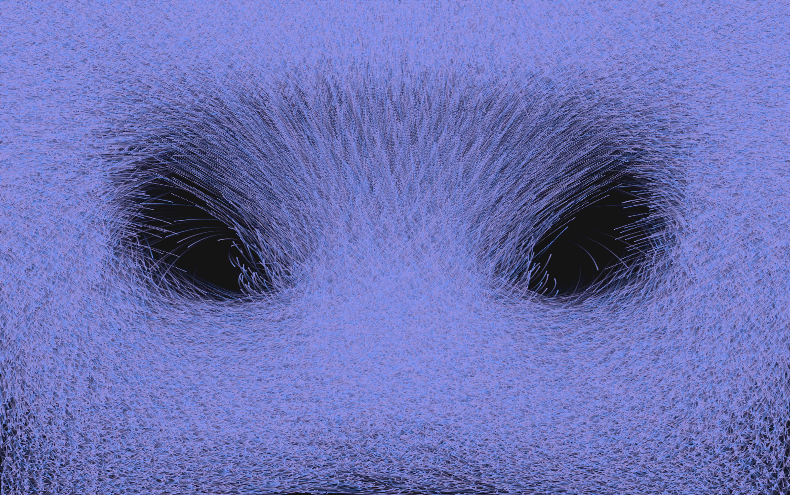
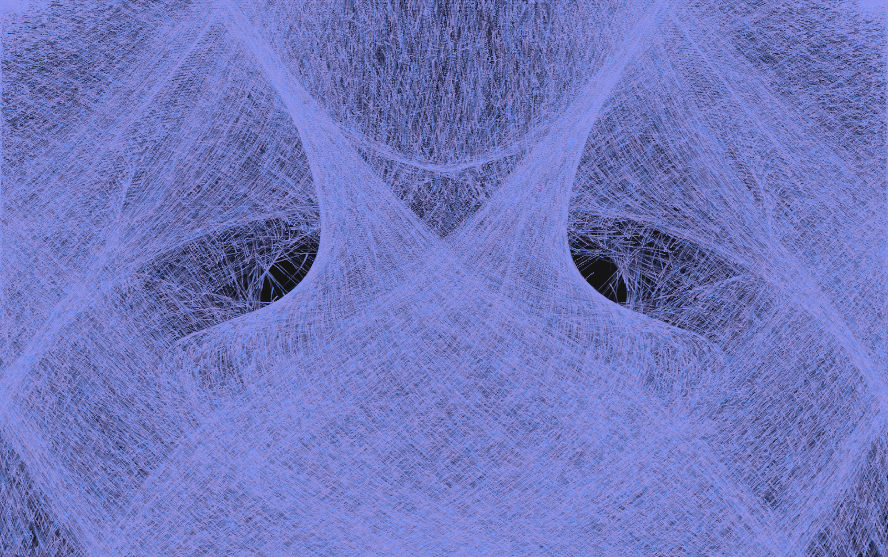
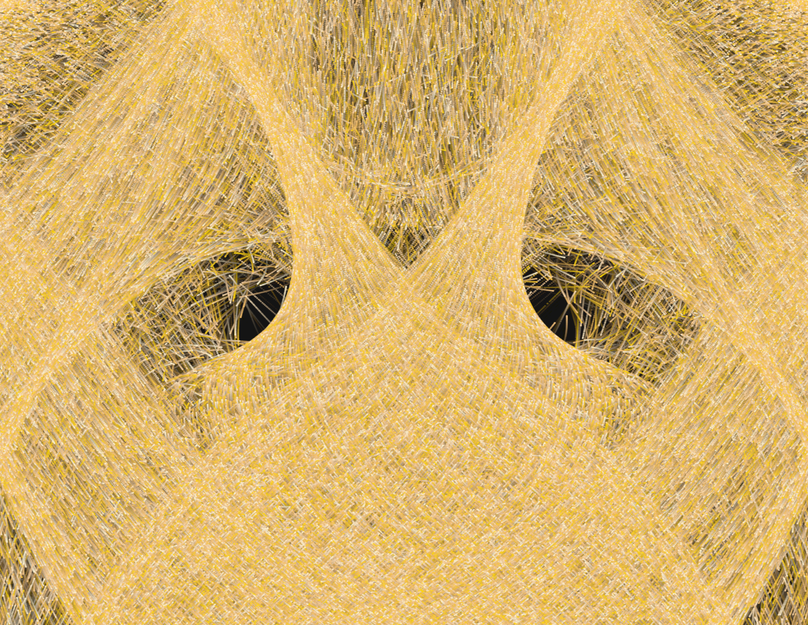
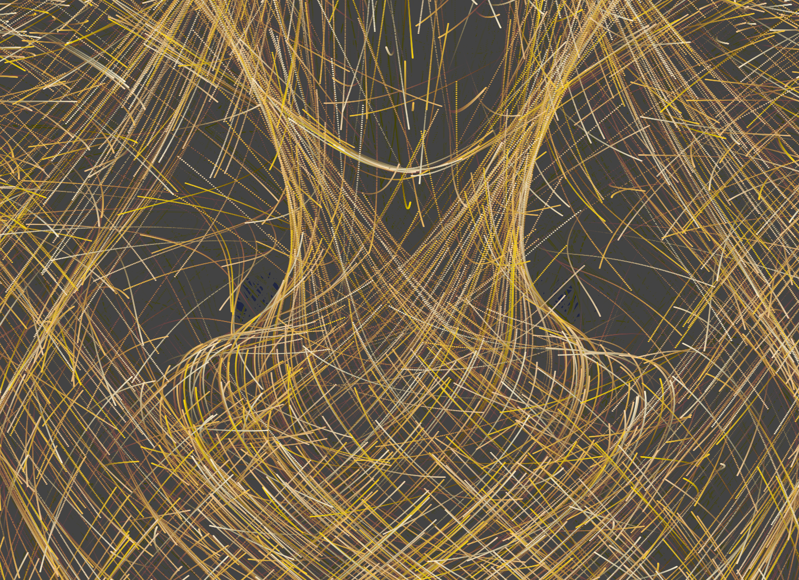

# Cosmic Particles

**A Rust + wgpu GPU particle visualization experiment**

Exploring GPU computing, particle simulation, shader programming, and real-time rendering with Rust, `wgpu`, `winit`, and WGSL.

[](https://www.rust-lang.org/)
[](https://wgpu.rs/)
[](https://www.w3.org/TR/WGSL/)

## Demo

Watch the particles move, form intricate patterns, and leave colorful trails.

**[▶ Watch the full demo video](https://youtu.be/07ur_Wi_ss4)**


## Screenshot
<table>
  <tr>
    <td></td>
    <td></td>
    <td></td>
    <td></td>
  </tr>
</table>


## About the Project

`cosmic-particles` is a personal project born out of curiosity about GPU programming with Rust.

After attending an online Rust meetup introducing `wgpu` and GPU development, I wanted to explore the concepts hands-on rather than stop at the theory. I started experimenting with GPU initialization, compute shaders, particle movement, rendering, and visual effects.

The goal was to understand how a native Rust application can use the GPU to update and render a large number of particles, and how shader logic and persistent trails can transform simple particle movement into a complex visual.

This was my first time exploring this area of graphics programming, and seeing the concepts turn into a working visual was genuinely fun.

## What I Explored

- **GPU computing with Rust** — exploring how computation can be moved to the GPU.
- **`wgpu`** — working with GPU resources, pipelines, command submission, and rendering.
- **WGSL shaders** — writing shader code for particle updates and visual rendering.
- **Particle simulation** — representing particle positions and velocities and updating particle state.
- **Procedural colors** — experimenting with color variation to create a cosmic-inspired appearance.
- **Persistent trails** — using intermediate textures and frame fading to retain previous particle positions.
- **Compute and render pipelines** — understanding the different responsibilities of GPU computation and graphics rendering.

## How It Works

The intended frame flow is:

```text
Particle State
     |
     v
GPU Compute Pass
Update particle positions
     |
     v
Trail Pass
Fade the previous frame
     |
     v
Particle Render Pass
Draw current particles
     |
     v
Presentation Pass
Display the resulting image
     |
     v
Window
```

### Particle computation

Particle positions and velocities are represented as structured data accessible to GPU shaders. A compute pass updates particle state, allowing the rendering pipeline to consume the updated positions.

### Particle rendering

A render pipeline processes particle data and produces the visual representation. WGSL shader logic controls particle placement, color variation, and the circular glow effect.

### Persistent trails

The trail effect uses two textures in a ping-pong arrangement:

1. Read the previous trail texture.
2. Fade its existing colors.
3. Draw the current particles into the other texture.
4. Present the completed image.
5. Swap the textures for the next frame.

The fade factor controls how quickly older pixels disappear. This allows the visualization to show a history of particle movement instead of only the current positions.

_The diagram describes the intended architecture. Individual implementation details and runtime behavior should be verified against the current source code._

## Technology Stack

| Technology            | Purpose                                       |
| --------------------- | --------------------------------------------- |
| Rust                  | Application logic and GPU resource management |
| `wgpu`                | Cross-platform GPU API                        |
| `winit`               | Native window and event handling              |
| WGSL                  | GPU compute and rendering shaders             |
| macOS / Apple Silicon | Development environment                       |

## Run Locally

### Prerequisites

- Rust and Cargo
- Git
- A graphics environment supported by `wgpu`

### Clone the repository

```bash
git clone https://github.com/NishantCoder108/cosmic-particles.git
cd cosmic-particles
```

Locate the directory containing the Rust application's `Cargo.toml` file. If the application is inside `triangle-lab`, enter that directory:

```bash
cd cosmic-particles
```

Check the project:

```bash
cargo fmt --check
cargo check
```

Run the application:

```bash
cargo run
```

## Experiments

The project offers several opportunities to explore GPU behavior and visual output:

- **Particle count:** observe how increasing the number of particles changes density and rendering workload.
- **Workgroup size:** experiment with compute dispatch configuration and compare performance.
- **Particle size:** adjust particle dimensions to create fine dust or larger glowing points.
- **Color palettes:** explore different combinations of background and particle colors.
- **Trail persistence:** tune the fade factor to balance visible trails against excessive accumulation.
- **Window resizing:** verify that surface configuration and size-dependent textures remain valid.

These experiments should be evaluated through actual runtime observations. A larger particle count does not automatically produce a better visual result, and a successful compilation alone does not establish rendering correctness or performance.

## What I Took Away

The most valuable part of this project was connecting unfamiliar GPU concepts to a visible result.

It gave me a practical starting point for understanding GPU resources, compute and render pipelines, shader programming, and how intermediate textures can be used to create visual effects.

I also learned that getting an image on screen is only one part of graphics programming. Resource initialization, rendering order, texture management, and validation all matter.

There is still more to explore, but this first experiment made GPU programming feel much more approachable and gave me the motivation to keep building.

## Connect with Me

I'm always happy to connect with people interested in Rust, Backend Engineer, Cloud Engineer, GPU programming, systems engineering, and open-source projects.

- **LinkedIn:** [Nishant — Connect with me](https://linkedin.com/in/nishantcoder/)
- **GitHub:** [NishantCoder108](https://github.com/NishantCoder108)

Feel free to connect, share constructive feedback, or discuss ideas around Rust, Backend and GPU computing.

## Acknowledgements

This project was inspired by the online meetup **“Rust and the GPU from Native to Web: An Introduction to `wgpu`.”**

Special thanks to:

- **[Liam](https://www.linkedin.com/in/liam-rust/)** — for the introduction to `wgpu` and GPU programming that sparked my curiosity to explore the subject hands-on.
- **[Gabor Szabo](https://linkedin.com/in/szabgab/)** — community organizer, for hosting the meetup.

The introduction was a great starting point for this first exploration into GPU programming with Rust. It was genuinely fun to experiment with the concepts and turn them into a visual project.

---

**Built with curiosity, Rust, and `wgpu`.**

[Repository](https://github.com/NishantCoder108/cosmic-particles) · [Liam on LinkedIn](https://www.linkedin.com/in/liam-rust/) · [Gabor Szabo on LinkedIn](https://linkedin.com/in/szabgab/)
